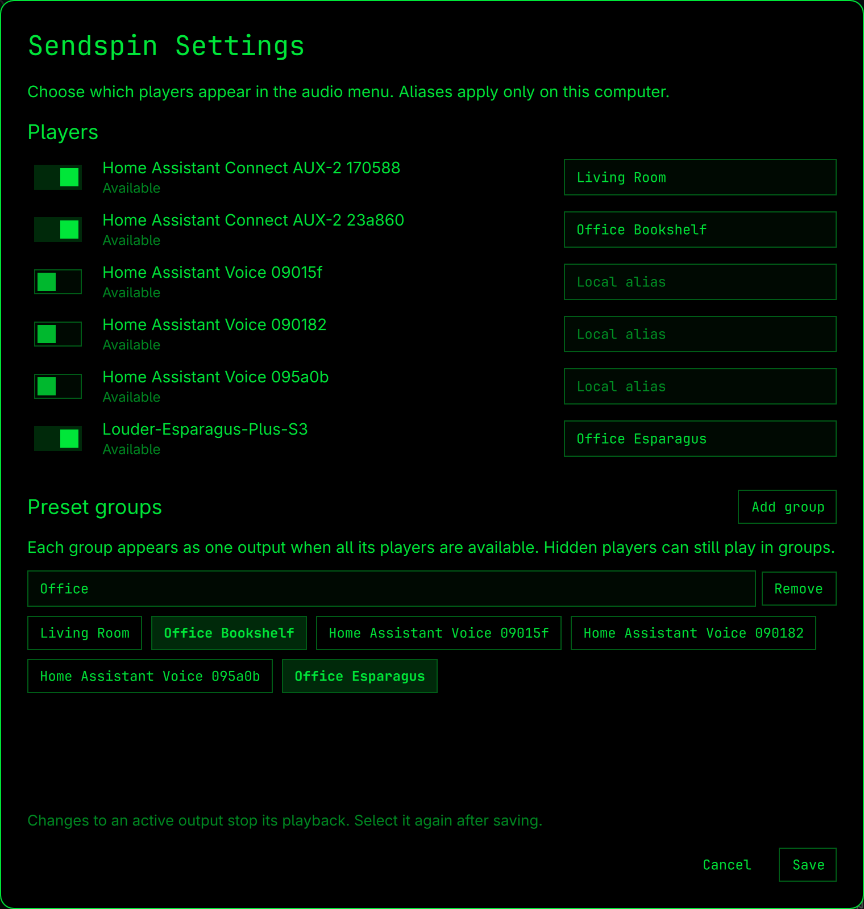

# Omarchy Sendspin

Send your computer's audio to a Sendspin player from Omarchy's speaker menu.

The plugin discovers players on the local network. Each player with unpaired access enabled appears as **Device name (Sendspin)** in the existing audio output picker. Select an output to move playing apps to it. Select your normal speakers or headphones to switch back. Volume, mute, and the per-app mixer use the normal audio controls.

No pairing code is required. Playback starts only when an app sends audio to a Sendspin output. Selecting an output authorizes that client's cryptographic identity for the playback session. Clients that require pairing do not appear. The bridge uses encrypted Sendspin connections and does not enable legacy unencrypted access.

## Install

Requires Omarchy with PipeWire's PulseAudio interface, `pactl`, `parec`, `pw-cli`, `uv`, and a systemd user session.

```sh
git clone https://github.com/balloobbot/omarchy-sendspin.git
cd omarchy-sendspin
./install.sh
```

The installer creates the plugin, its Python environment, and a user service. Omarchy starts the service when the plugin is enabled. Discovery runs in the background while enabled. The bridge advertises a Sendspin server on TCP port 8929 and discovers clients through mDNS on UDP port 5353. It supports clients that connect to servers and clients that advertise themselves.

After an update, run `omarchy restart shell` if the panel still shows old controls. Save or cancel open settings first.

The plugin uses the stock audio menu. It does not replace or copy Omarchy's audio plugin.

```sh
omarchy plugin disable paulus.sendspin
omarchy plugin enable paulus.sendspin
```

Disabling the plugin stops the bridge and removes its outputs. If a selected player disconnects or playback fails, the bridge moves affected apps back to the last local output. The next startup removes outputs left by an interrupted shutdown.

## Settings

Open **Sendspin Settings** from the app launcher. The speaker menu stays unchanged.



- Use a player's switch to show or hide its individual output.
- Enter a local alias to change its label on this computer. The device's name stays unchanged.
- Add a preset group, enter its name, and select 2–32 players. The group appears as a separate output when all members are available. Hidden players can still belong to groups.
- Select a group in the audio menu to play one synchronized stream on its members. A player can play in only one active output at a time. When outputs overlap, the selected default takes priority and conflicting apps move to it.
- Save applies the changes. Editing or hiding an active output stops that output and moves its apps to your local speakers. Select the output again to resume.

Settings remember offline players. Pairing management is not implemented yet; this panel is its planned location.

You can also open the panel with `omarchy-shell shell toggle paulus.sendspin`.

## Scope

- Up to 32 unpaired players and 32 preset groups are exposed as separate outputs.
- Audio is captured as 48 kHz stereo PCM. The Sendspin library converts it to a format the player supports.
- Live-audio mode avoids the extra lead time used for buffered media. Capture uses 10 ms chunks and requests a 10 ms PulseAudio buffer. Each player’s advertised minimum buffer, codec delay, and output delay still apply. The library also enforces a 50 ms scheduling floor; this is not an end-to-end latency guarantee.
- This version has no video delay compensation.
- Device renaming is not supported by the Sendspin specification. Local aliases do not change the device.
- Volume keys and the output slider send volume and mute commands to players that support remote volume. The slider initially adopts the player’s level. Mute preserves the selected volume, and reconnecting retains your local selection. Players without remote volume support use local audio gain instead. Per-app volume remains local.
- Group volume sets all members to the same level when every member supports remote volume. A group with any member without remote volume uses local audio gain.
- No microphone capture, pairing management, or persistent client approvals.

## Files and diagnostics

Installed files use the XDG directories, with these defaults:

- Plugin: `~/.config/omarchy/plugins/paulus.sendspin/`
- Runtime and Python environment: `~/.local/share/omarchy-sendspin/`
- Settings: `~/.config/omarchy-sendspin/settings.json`
- Known players: `~/.local/state/omarchy-sendspin/players.json`
- Launcher entry: `~/.local/share/applications/omarchy-sendspin-settings.desktop`
- Server identity: `~/.local/state/omarchy-sendspin/identity`
- User service: `~/.config/systemd/user/omarchy-sendspin.service`

```sh
systemctl --user status omarchy-sendspin.service
journalctl --user -u omarchy-sendspin.service
pactl list short sinks
```

To uninstall, disable the plugin first. Remove the paths above and run `systemctl --user daemon-reload`.

## Development

```sh
uv sync
uv run ruff check .
uv run ruff format --check .
uv run pytest
SENDSPIN_AUDIO_TEST=1 SENDSPIN_UI_TEST=1 uv run pytest
omarchy plugin validate "$PWD/plugin"
```

The optional audio tests need a running local PipeWire server. They create a temporary virtual output and a local Sendspin receiver. The receiver checks the audio bytes without playing them aloud. Tests cover both connection directions, live-audio scheduling, output names, remote volume commands, local volume fallback, mute, and cleanup.

Protocol implementation: [aiosendspin](https://github.com/Sendspin/aiosendspin).
